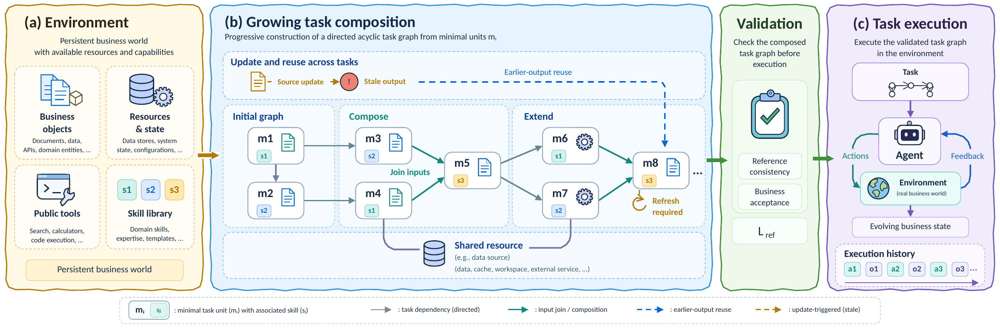
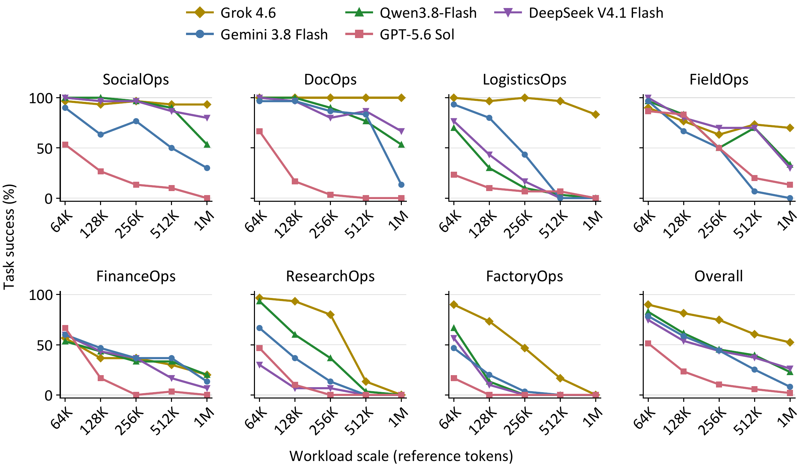

# SkillHorizon

**Constructing Long-Horizon Agent Tasks through Skill Composition**

[Repository](https://github.com/HKUST-KnowComp/SkillHorizon) |
[Task Guide](docs/TASKS.md) |
[Resource Setup](docs/RESOURCES.md) |
[Paper Figures](docs/FIGURES.md)

SkillHorizon provides seven stateful business environments, configurable task
generators, skill resources, and automatic business scoring. Generate tasks,
connect an agent, and evaluate its ability to complete dependent business work.



Tasks grow through dependencies, shared resources, and updates. Public reference
executions validate business completion and measure reference workload before
agents interact with the resulting environment.

## Environments

| Environment | Business work | Generator |
|---|---|---|
| FinanceOps | Reconcile financial evidence and close dependent stages | [financeops](src/skillhorizon/financeops/) |
| FieldOps | Coordinate maintenance, resources, and downstream services | [fieldops](src/skillhorizon/fieldops/) |
| SocialOps | Coordinate campaign content, approvals, releases, and learning | [socialops](integrations/socialops/) |
| LogisticsOps | Coordinate itineraries, reservations, and handoffs | [logisticsops](integrations/logisticsops/) |
| ResearchOps | Accumulate, verify, and combine research evidence | [researchops](integrations/researchops/) |
| DocOps | Produce and review dependent document contracts | [docops](integrations/docops/) |
| FactoryOps | Coordinate materials and production operations | [factoryops](integrations/factoryops/) |

Tasks combine local goals with artifact dependencies, shared resources, and
state changes. Skills provide procedures and, where applicable, executable
scripts. Business state persists across agent interactions.

## Main Results



Task success across 64K, 128K, 256K, 512K, and 1M reference-workload bands.
The Overall panel pools the seven environments with equal task weight.
See the [paper figure gallery](docs/FIGURES.md) for progress, delivery,
recovery, and task-sampling analyses.

## Installation

Use Python **3.12** on Linux or macOS and run commands from the repository root:

```bash
git clone https://github.com/HKUST-KnowComp/SkillHorizon.git
cd SkillHorizon
python3.12 -m venv .venv
source .venv/bin/activate
python -m pip install -r requirements.txt
python run.py --help
```

The default runner uses **Harbor + Inspect** and does not require Docker.
Native Terminus-2, Codex, and Claude Code execution requires Docker separately.

## Generate a Task

FinanceOps and FieldOps generate their initial worlds programmatically:

```bash
python run.py build --environment FinanceOps --output tasks/finance-small
```

Construction runs a public reference policy, checks its business outcome, and
measures the reference interaction tokens. It does not call a model API.
Tokenization downloads its vocabulary on first use unless a populated
`TIKTOKEN_CACHE_DIR` is supplied for offline operation.

The other five environments require external database templates and MCP support
files. Follow [Resource Setup](docs/RESOURCES.md), then build with:

```bash
export SKILLHORIZON_EXTERNAL_ASSETS=/path/to/external-assets
python run.py build --environment DocOps --output tasks/doc-small
```

Use constructor parameters to vary scale, dependencies, and update conditions:

```bash
python run.py build --environment FinanceOps --output tasks/finance-custom \
  --config examples/finance-small.json
```

The [task guide](docs/TASKS.md) describes configuration and the **1,050 selected
task construction records** in `manifests/`. Each output directory must be new.

## Evaluate an Agent

### Harbor + Inspect

Harbor creates the agent and verifier; Inspect drives model generation and tool
dispatch. Domain runtimes maintain business state and determine final scores.
The controller manages action parsing, business-call budgets, feedback, and
context compaction.

```text
Task generator -> initial world + public task + skills + reference
                                     |
Harbor -> Inspect agent -> public business tools -> persistent world
                                     |                   |
                              context compaction    business evaluator
                                                         |
                                                   Harbor verifier
```

Supply `SKILLHORIZON_API_KEY` through your process environment, then run:

```bash
python run.py run --task tasks/finance-small --output runs/finance-model \
  --model YOUR_MODEL_ID --max-calls 400 --max-provider-responses 500
```

The controlled provider defaults to OpenLux Chat Completions. `--endpoint`
selects a compatible endpoint. Running this command sends public task messages
and tool results to the provider and incurs API usage. Credentials are never
command-line values; the runner does not load `.env` files.

`--max-calls` sets the business-tool allowance B. `--max-provider-responses`
sets a separate accepted-response limit. Defaults use medium reasoning,
8,192 output tokens per response, a 200,000-token compaction trigger, and a
480,000-token input capacity. Multiple actions execute serially and stop at the
first error. Skill declarations are recorded separately from charged business
calls; infrastructure retries have separate accounting.

### Native Harbor Agents

Export the same task for Terminus-2, Codex, or Claude Code:

```bash
python run.py native prepare tasks/finance-small tasks/finance-terminus \
  --agent terminus-2 --model openai/YOUR_MODEL_ID --max-calls 400
```

Preparation is offline. Native agents own their decision loops and context
management. Codex and Claude Code also require `--agent-version` with an exact
CLI version. See [Native Harbor Agents](integrations/native_agents/README.md)
for preparation, Docker execution, provider configuration, and sandbox details.

## Scores and Outputs

Each controlled run writes `runs/.../summary.json` with:

- **Task success:** whether the terminal business state satisfies all requirements.
- **Local-goal completion:** completed / required native business goals.
- The stop reason, business-call count, and domain evaluation.

`scoring.py` extracts these metrics from domain evaluations.
`inspect_private/RESULT.json` and neighboring logs retain execution details.
A successful script call or final answer alone does not imply task success.

Reference workload counts public reference calls and results, including repeated
reads. It is distinct from the agent's current context window and measured run
length. The builder records it in `manifest.json`.

## Optional Offline Checks

```bash
python run.py smoke --output runs/framework-smoke
python run.py check-reference --task tasks/finance-small \
  --output runs/finance-reference --max-calls 400
```

`smoke` checks framework wiring with a synthetic gateway. `check-reference`
executes saved reference actions through Harbor + Inspect and the environment.
Neither calls a model API. Small task construction and reference business
acceptance have been checked for all seven environments using the external
resources described above. Fresh Python 3.12 installation, the FinanceOps
Harbor + Inspect reference path, and Terminus-2 preparation have also been
checked. Native Docker execution and live provider integration need separate
checks.

## Repository Layout

- `run.py`: task construction and agent execution CLI.
- `src/skillhorizon/financeops/`, `src/skillhorizon/fieldops/`: FinanceOps and FieldOps generators and runtimes.
- `integrations/{socialops,logisticsops,researchops,docops,factoryops}/`: the other five environments, their skills, and evaluators.
- `integrations/inspect_agent/`, `integrations/harbor/`: Harbor + Inspect runner.
- `integrations/native_agents/`: native Harbor agent adapters.
- `scoring.py`: native business-score extraction.
- `manifests/`: selected task construction records, 150 per environment.
- `examples/`, `docs/`: small configurations and usage documentation.

External assets, credentials, generated tasks, execution logs, and historical
model-result tables are not included. Resource provenance and licensing are
described in [THIRD_PARTY_NOTICES.md](THIRD_PARTY_NOTICES.md).

## Citation

```bibtex
@misc{liu2026skillhorizon,
  title={SkillHorizon: Constructing Long-Horizon Agent Tasks through Skill Composition},
  author={Yuxuan Liu and Zhaochen Su and Hangyu Guo and Shijue Huang and
          Zhixiong Zhang and Kawai Chung and Zhongwei Xie and Tianshi Zheng and
          Wei Fan and Qing Zong and Haochen Shi and Baixuan Xu and Haoran Li and
          Yangqiu Song},
  year={2026},
  url={https://github.com/HKUST-KnowComp/SkillHorizon}
}
```
