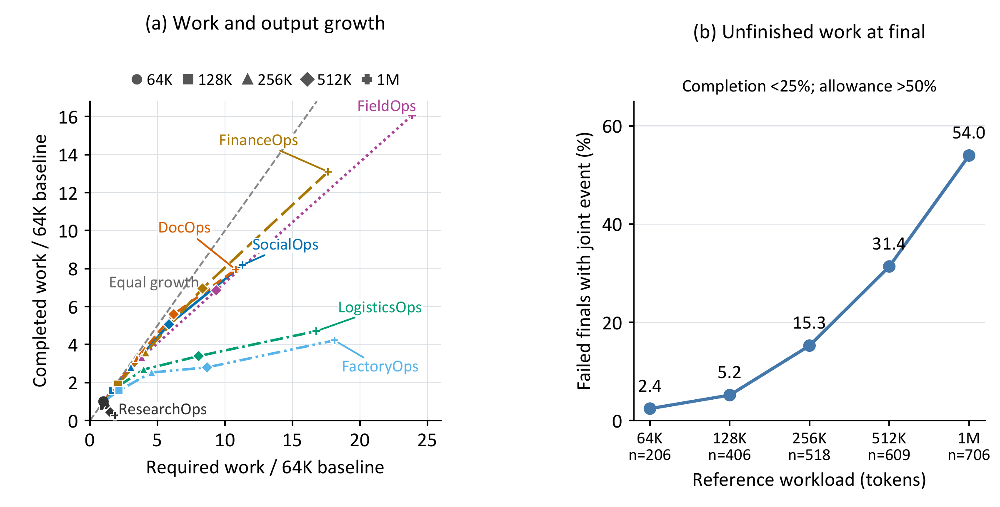
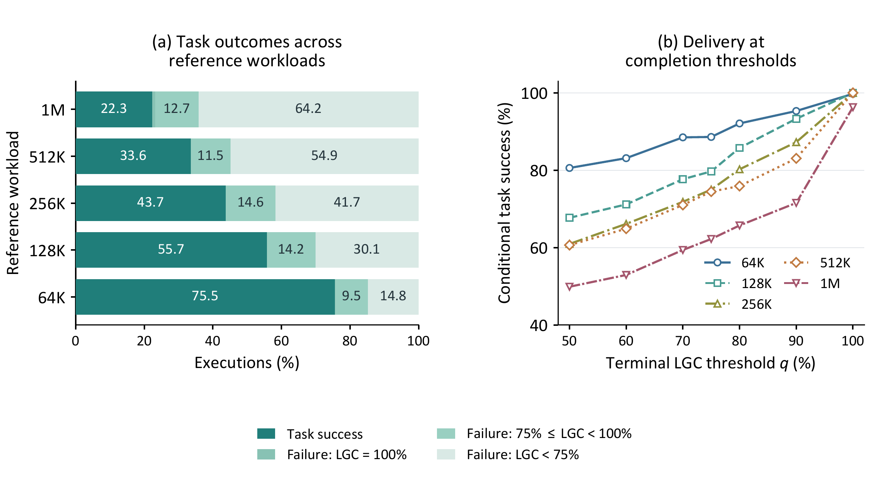
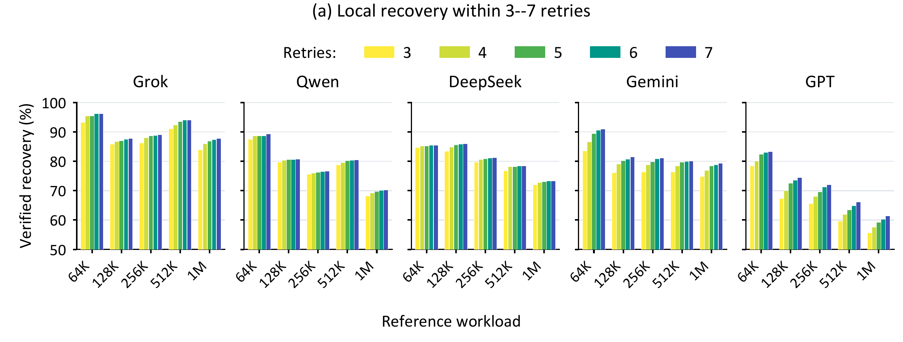
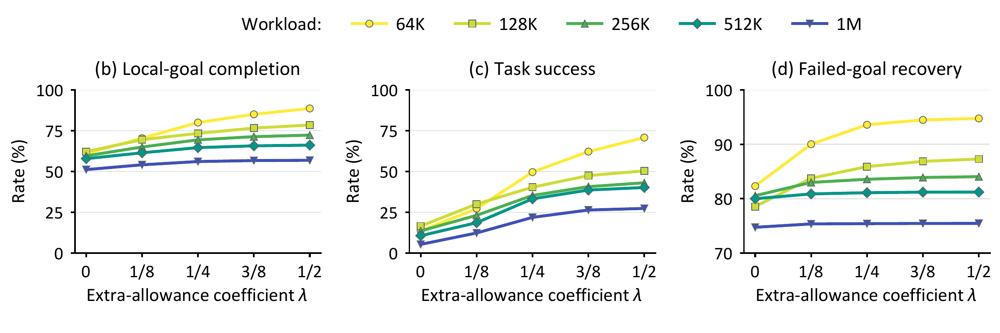
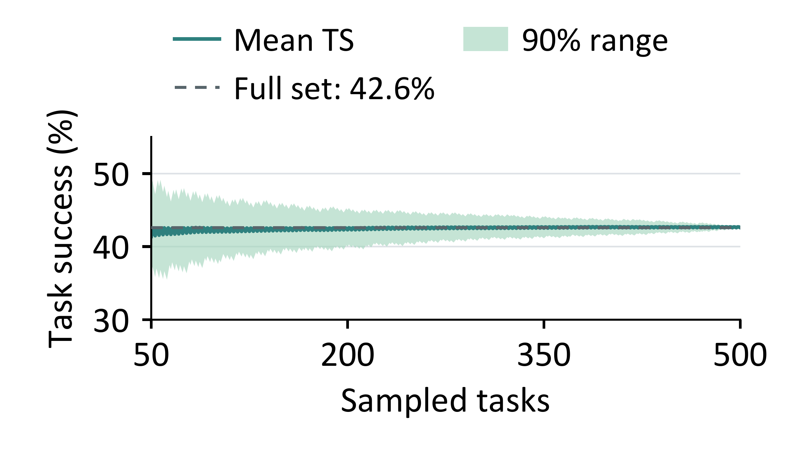

# Paper Figures

Figures from *SkillHorizon: Constructing Long-Horizon Agent Tasks through Skill
Composition*, rendered from the figure PDFs used by the manuscript.

## 1. Task Construction

Environments provide business objects, resources, tools, and skills. Tasks grow
through dependencies, shared resources, and updates requiring downstream refresh.
Public reference execution validates business completion and measures workload.

## 2. Task Success

Task success across seven environments and five reference-workload bands.
Each environment point includes 30 tasks per model; each Overall point includes
210 tasks per model, pooled with equal task weight.

## 3. Sustained Progress

Left: growth in required and completed local goals relative to 64K.
Right: the share of measured failed final answers with less than 25% goal
completion and more than 50% tool allowance remaining.

## 4. Local Progress and Global Delivery

Left: task outcomes and remaining local work by workload band.
Right: task success among executions reaching each local-goal completion threshold.

## 5. Recovery over Long Horizons

Task-averaged recovery within three to seven subsequent checks of the same goal
and obligation cycle, grouped by model and workload.

Local-goal completion, task success, and failed-goal recovery along fixed
trajectory prefixes at increasing business-call allowances. These panels use the
same 3,374 executions with public failures by the reference allowance and retain
earlier terminal states.

## 6. Task-Sampling Sensitivity

Mean and central 90% range across 1,000 family-balanced sampled orders of
500 FinanceOps tasks at 128K evaluated with Gemini 3.8 Flash. The dashed line
marks the full-set task success of 42.6%.
